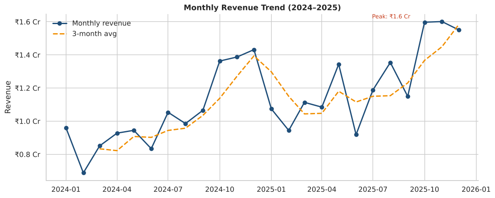
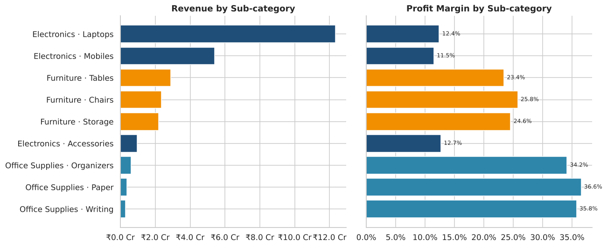
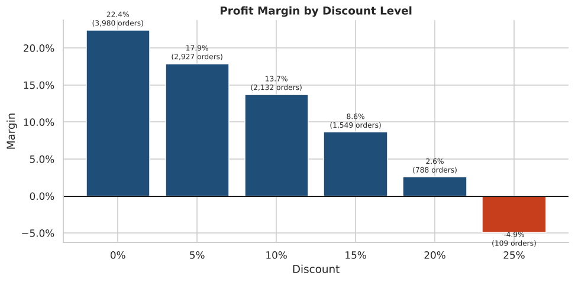
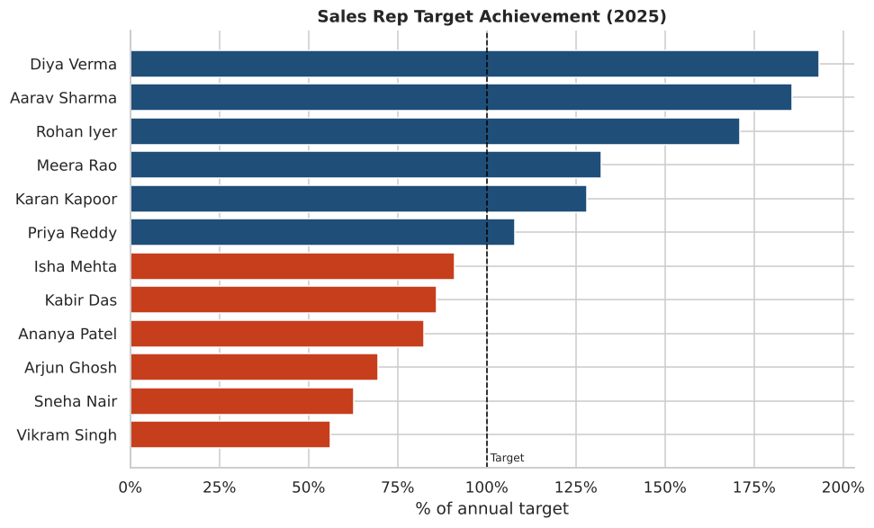
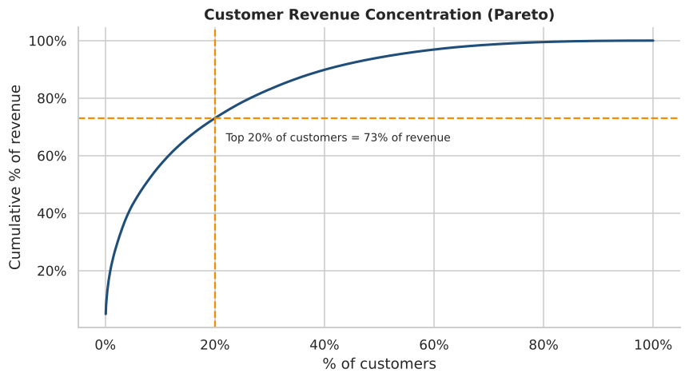
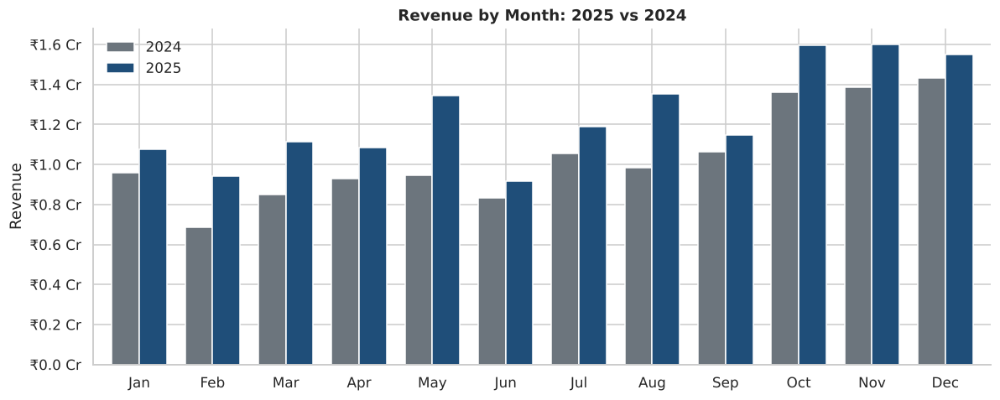
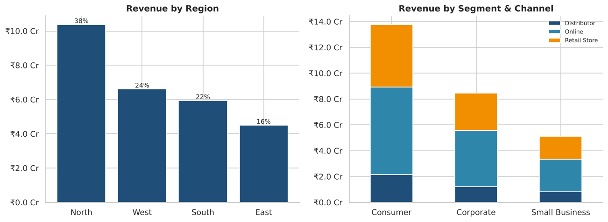
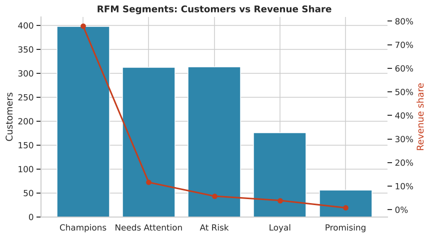

# 📊 Sales Performance Analysis — SQL · Python · Power BI

An end-to-end, associate-level **Sales / Business Analyst** portfolio project.
It takes two years (2024–2025) of retail sales for an Indian company with four regions,
cleans the data, answers real business questions in **SQL**, digs deeper with
**Python (pandas, matplotlib, seaborn)**, and presents the results in a **Power BI** dashboard.


---

## 🎯 Business questions

1. How much revenue and profit did we make, and how fast are we growing?
2. Which months, categories, products and regions drive sales?
3. Are discounts helping or hurting profitability?
4. Which sales reps are hitting their targets?
5. Who are our most valuable customers, and who is at risk of churning?

## 🧰 Skills demonstrated

| Area | What's in this project |
|---|---|
| **SQL** | Star-schema DDL, data-quality checks, CTEs, `JOIN`s, `CASE WHEN`, aggregations, window functions (`LAG`, `RANK`, `DENSE_RANK`, `NTILE`, running totals, rolling averages), YoY/MoM growth, Pareto, RFM segmentation, cohort retention, churn with `EXCEPT` |
| **Python** | pandas merging/cleaning, de-duplication, null handling, feature engineering, `groupby`/`pivot_table`, `qcut` RFM scoring, matplotlib/seaborn charts, reproducible scripts |
| **Power BI** | Power Query (M) ETL, star-schema data model, DAX date table, time intelligence (`SAMEPERIODLASTYEAR`, `TOTALYTD`, `DATEADD`), `RANKX`, targets vs actuals, conditional formatting, custom theme JSON, drill-through & slicers |
| **Business** | KPI definition, storytelling with data, actionable recommendations |

## 📁 Repository structure

```
sales-performance-analysis/
├── data/                      # star-schema CSVs (generated, reproducible)
│   ├── fact_sales.csv         # 12,015 order lines (incl. 15 dups + 25 nulls to clean)
│   ├── dim_customers.csv      # 1,500 customers
│   ├── dim_products.csv       # 21 products, 3 categories, 9 sub-categories
│   ├── dim_regions.csv        # North / South / East / West
│   ├── dim_sales_reps.csv     # 12 reps with annual targets
│   ├── kpi_summary.csv        # output of the Python analysis
│   └── rfm_scores.csv         # output: RFM score per customer
├── sql/
│   ├── 01_schema.sql          # tables, keys, indexes
│   ├── 02_data_cleaning.sql   # quality checks + v_sales_clean view
│   ├── 03_kpi_analysis.sql    # 9 core KPI queries
│   └── 04_advanced_analysis.sql # 8 window-function / CTE queries
├── python/
│   ├── generate_data.py       # creates the dataset (seeded)
│   ├── load_to_sqlite.py      # builds data/sales.db and runs all SQL
│   ├── sales_analysis.py      # full EDA + charts + RFM
│   └── dashboard_mockup.py    # renders the dashboard preview image
├── powerbi/
│   ├── power_query.m          # M scripts for every table
│   ├── dax_measures.dax       # date table + 35 DAX measures
│   ├── sales_theme.json       # report theme
│   └── dashboard_guide.md     # step-by-step build guide (4 pages)
├── images/                    # all charts
└── requirements.txt
```

## 🚀 How to run

```bash
git clone https://github.com/Abhi1803-hash/sales-performance-analysis.git
cd sales-performance-analysis
pip install -r requirements.txt

python python/generate_data.py      # 1. (optional) regenerate the CSVs
python python/load_to_sqlite.py     # 2. build SQLite DB + run every SQL query
python python/sales_analysis.py     # 3. Python analysis → images/ + data/
python python/dashboard_mockup.py   # 4. dashboard preview image
```

SQL is written for **SQLite** so it runs with zero setup. To use PostgreSQL/MySQL, replace
`strftime('%Y', d)` with `EXTRACT(YEAR FROM d)` / `YEAR(d)` and `julianday(a) - julianday(b)`
with `a - b` / `DATEDIFF(a, b)`.

For Power BI, follow [`powerbi/dashboard_guide.md`](powerbi/dashboard_guide.md).

---

## 📈 Headline KPIs (net of returns)

| KPI | 2024 | 2025 | YoY |
|---|---:|---:|---:|
| Revenue | ₹12.49 Cr | ₹14.92 Cr | **+19.4 %** |
| Profit | ₹2.05 Cr | ₹2.50 Cr | **+22.1 %** |
| Profit margin | 16.4 % | 16.8 % | +0.4 pp |
| Orders | 5,350 | 6,135 | +14.7 % |
| Active customers | 1,030 | 1,096 | +6.4 % |
| Avg order value | ₹23,350 | ₹24,319 | +4.2 % |
| Return rate | 4.5 % | 4.1 % | −0.4 pp |

## 🔍 Key insights

**1. Strong growth with a festive peak.** Revenue grew 19.4 % YoY and every month of 2025
beat 2024. Oct–Dec contributes **33 %** of annual revenue; February and June are the weakest months.



**2. Electronics sells, Office Supplies earns.** Electronics brings in **68 %** of revenue but
at only ~12 % margin. Office Supplies is small (5 % of revenue) but runs at **34–37 %** margin.
Laptops alone are 45 % of revenue.



**3. Deep discounts destroy profit.** Margin falls from 22.4 % at no discount to 2.6 % at 20 %,
and orders at **25 % discount are loss-making (−4.9 %)**, all of them from the festive season.



**4. Regional imbalance.** North generates **38 %** of revenue; East only 16 %. All three North
reps beat target (171–193 %) while all three East reps missed (56–70 %).



**5. Revenue is concentrated.** The top 20 % of customers deliver **73 %** of revenue.
RFM shows 398 *Champions* (78 % of revenue) and 313 *At Risk* customers who haven't ordered
in ~13 months. 159 customers who bought in 2024 did not return in 2025.



## ✅ Recommendations

1. **Cap festive discounts at 15–20 %** and use bundles (laptop + accessories) instead of
   flat 25 % discounts — protects ~5 pp margin on peak-season orders.
2. **Cross-sell high-margin Office Supplies** and accessories to Corporate electronics buyers.
3. **East region turnaround**: review targets (two of three East reps carry ₹1.3 Cr targets in the
   smallest market), share North's playbook, and add channel partners.
4. **Retention programme** for *Champions* (loyalty perks) and a win-back campaign for the
   313 *At Risk* customers.
5. **Plan inventory and staffing** for Oct–Dec; run February/June promotions to smooth the dips.

## 🖼️ More charts

| | |
|---|---|
|  |  |
|  |  |

---

*Dataset is synthetic, generated with a fixed seed by `python/generate_data.py` to mimic
realistic patterns (seasonality, YoY growth, Pareto customers, data-quality issues).*
