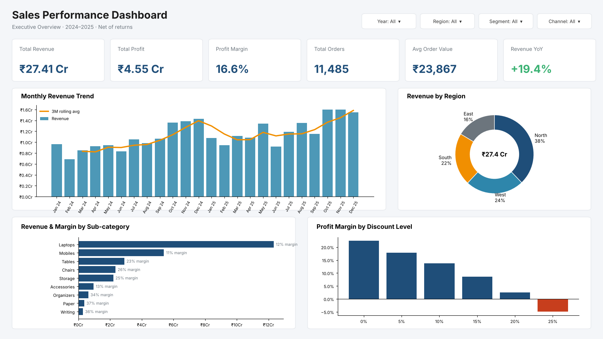

# Power BI Dashboard – Build Guide

Step-by-step instructions to rebuild the **Sales Performance Dashboard** in Power BI Desktop
from the files in this folder. Time: ~45 minutes.



---

## 1. Load the data (Power Query)

1. **Home → Transform data → Manage Parameters → New**: name `FolderPath`, type *Text*,
   value = full path to this repo's `data\` folder (keep the trailing `\`).
2. **New Source → Blank Query → Advanced Editor** and paste each block from
   [`power_query.m`](power_query.m). Rename each query to its table name
   (`fact_sales`, `dim_products`, `dim_customers`, `dim_regions`, `dim_sales_reps`).
3. Cleaning steps already included in `fact_sales`:
   - remove duplicate `order_id` rows (15 duplicates in the raw file)
   - replace blank `channel` with `Unknown` (25 rows)
   - add `ship_days` and `discount_band` columns
4. **Close & Apply**.

## 2. Build the data model (star schema)

Create the date table from [`dax_measures.dax`](dax_measures.dax) (section 1),
then **Table tools → Mark as date table** on `DimDate[Date]`.
Sort `DimDate[Month]` by `DimDate[Month No]`.

In **Model view** create these relationships (all *Many-to-One*, single direction):

| From (many)              | To (one)                   |
|--------------------------|----------------------------|
| `fact_sales[order_date]` | `DimDate[Date]`            |
| `fact_sales[product_id]` | `dim_products[product_id]` |
| `fact_sales[customer_id]`| `dim_customers[customer_id]` |
| `fact_sales[region_id]`  | `dim_regions[region_id]`   |
| `fact_sales[rep_id]`     | `dim_sales_reps[rep_id]`   |

```
                 DimDate
                    │
dim_products ── fact_sales ── dim_customers
                 │       │
        dim_regions   dim_sales_reps
```

Hide foreign-key columns in `fact_sales` from Report view.

## 3. Add measures

Create an empty table named `_Measures` (**Home → Enter data → Load**) and add every
measure from `dax_measures.dax` sections 2–6. Formatting:

| Measure group                         | Format                    |
|---------------------------------------|---------------------------|
| Revenue, Profit, AOV, Target          | Currency ₹, 0 decimals, display units *Lakhs/Crores* via custom `₹#,##,##0` |
| `%` measures                          | Percentage, 1 decimal     |
| Orders, Customers, Units              | Whole number, thousands separator |

## 4. Apply the theme

**View → Themes → Browse for themes** → select [`sales_theme.json`](sales_theme.json).

## 5. Report pages

### Page 1 – Executive Overview
| Visual | Fields |
|---|---|
| 6 × **Card (new)** | Total Revenue, Total Profit, Profit Margin %, Total Orders, Avg Order Value, Revenue YoY % (reference label = Revenue PY) |
| **Line & clustered column** | X: `DimDate[Year-Month]`; Column: Total Revenue; Line: Revenue 3M Rolling Avg |
| **Clustered bar** | Y: `dim_products[sub_category]`; X: Total Revenue; tooltip: Profit Margin % |
| **Donut** | Legend: `dim_regions[region_name]`; Values: Total Revenue |
| **Slicers** | `DimDate[Year]` (tile), `dim_regions[region_name]` (dropdown), `dim_customers[segment]` (dropdown), `fact_sales[channel]` |

### Page 2 – Product & Profitability
- **Matrix**: rows `category` → `sub_category` → `product_name`; values Revenue, Profit,
  Profit Margin %, Units Sold, Product Rank. Conditional formatting: *Margin Colour* measure
  as font colour, data bars on Revenue.
- **Clustered column**: X `fact_sales[discount_band]`; Y Profit Margin % → shows that
  discounts >20% are loss-making.
- **Scatter**: X Avg Discount %, Y Profit Margin %, size Total Revenue, details `product_name`.

### Page 3 – Sales Team
- **Table**: rep_name, region_name, Total Revenue, Sales Target, Target Achievement %,
  Target Status, Rep Rank. Background colour rule on Target Achievement % (<100% red).
- **Bullet-style bar**: Clustered bar with Total Revenue and Sales Target per rep.
- **Map / Filled map**: Location `dim_customers[city]`, size Total Revenue.

### Page 4 – Customer Insights
- Cards: Active Customers, New Customers, Repeat Customer %, Revenue per Customer.
- **Stacked column**: X `segment`, legend `channel`, Y Total Revenue.
- **Line**: Year-Month vs New Customers and Repeat Customers.
- Optional: import `data/rfm_scores.csv` (produced by `python/sales_analysis.py`), relate on
  `customer_id`, and show a bar of customers by RFM `segment`.

## 6. Interactivity & polish
- Add a **Dashboard Title** card using the dynamic title measure.
- **Drill-through**: page 2 on `product_name`, page 3 on `rep_name`.
- **Bookmarks + buttons** for page navigation; sync slicers across pages (**View → Sync slicers**).
- Add tooltip pages for monthly trend (Revenue, Profit, Orders, MoM %).
- Turn off visual headers for a clean look; align visuals using **Format → Align**.

## 7. Publish
Save as `powerbi/Sales_Dashboard.pbix`, then **Publish** to Power BI Service
(or export as PDF: **File → Export → PDF**) and add the screenshot to the README.

---

### Expected numbers (to validate your build)

| KPI (2024–2025, net of returns) | Value |
|---|---|
| Total Revenue | ₹27.41 Cr |
| Total Profit | ₹4.55 Cr |
| Profit Margin | 16.6 % |
| Total Orders | 11,485 |
| Avg Order Value | ₹23,867 |
| Revenue YoY (2025 vs 2024) | +19.4 % |
| Return Rate | ~4.3 % |
